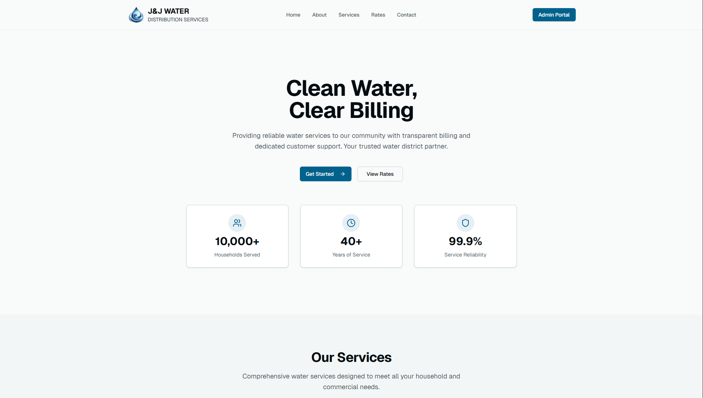
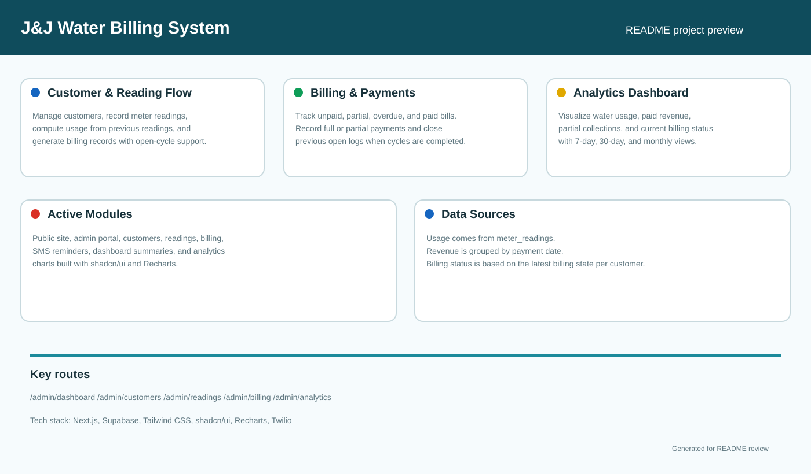

# J&J Water Billing System

Next.js and Supabase water billing platform for **J&J Water Distribution Services**. The project includes a public site, an admin portal, customer and meter-reading management, billing and payment tracking, SMS reminders, and an analytics dashboard.




## Overview

This project is built around the billing flow used by a small water distribution business:

1. Admin registers and manages customers.
2. Staff records meter readings.
3. The system generates billing records from those readings.
4. Finance records full or partial payments.
5. Dashboard and analytics pages summarize usage, collections, and account status.

## Main Modules

- Public pages: home, about, contact
- Admin login: `/admin/login`
- Dashboard: `/admin/dashboard`
- Customers: `/admin/customers`
- Meter readings: `/admin/readings`
- Billing management: `/admin/billing`
- Analytics: `/admin/analytics`
- SMS logs and reminders

## Auth Model

Admin access is restricted to exactly two profiles: one `finance` user and one
`reader` user. Each deployment can assign different email addresses without
changing application code.

The login flow is:

1. Submit approved email + password
2. Verify the password against Supabase Auth
3. Receive a 6-digit email OTP
4. Verify the OTP to create the session
5. Resolve the final role from `public.admin_profiles`

## Tech Stack

- Next.js App Router
- React
- Tailwind CSS
- shadcn/ui
- Recharts via shadcn Chart components
- Supabase Auth + Postgres

## Local Setup

### 1. Install dependencies

```bash
npm install
```

## Environment Setup

This project uses two main environment files:

- `.env.business` = live business database
- `.env.test` = developer/test database

Copy `.env.example` to create either file when setting up a new checkout, then
populate the ignored file with the credentials for its corresponding Supabase
project.

Do not manually edit `.env.local`. It is generated by the switching scripts.
Developers should only manually edit `.env.business` and `.env.test`.

The application consumes the stable `FINANCE_SMTP_*` and `READER_SMTP_*`
variables. In `.env.business`, these use the owner mailboxes. In `.env.test`,
they must mirror the corresponding developer SMTP settings.

Business:

```bash
npm run env:business
npm run dev
```

or:

```bash
npm run dev:business
```

Test:

```bash
npm run env:test
npm run dev
```

or:

```bash
npm run dev:test
```

Important: Never commit `.env.business`, `.env.test`, or `.env.local`.
Only `.env.example` is safe to commit.

### 3. Run database scripts in Supabase SQL Editor

Run these in order:

1. `scripts/001_create_tables.sql`
2. `scripts/002_add_partial_payment_support.sql`
3. `scripts/003_create_analytics_functions.sql`
4. `scripts/004_add_contact_submission_subject.sql`
5. `scripts/005_allow_meter_reading_updates.sql`
6. `scripts/006_allow_contact_submission_deletes.sql`
7. Continue applying the remaining numbered scripts in ascending order through
   `scripts/018_allow_expired_customer_cascade_delete.sql`.

Migration 017 replaces customer hard deletion with a 60-day archive. Finance
admins may permanently delete an unexpired archive only when it has no remaining
billing balance. Migration 018 allows expired archives to be deleted regardless
of balance; the existing foreign keys also delete related billings, readings,
and SMS logs. Run `scripts/report-expired-customer-archives.sql` to review archive
expiration, balances, and deletion eligibility without changing data.

### 4. Provision admin accounts

The Business database supports four admin accounts: an owner and developer for
each `finance` and `reader` role. Migration 016 classifies and protects the two
existing owners, then permits one developer profile per role.

Configure the ignored `.env.business` file with the existing owner emails and
the two developer accounts:

```env
NEXT_PUBLIC_SUPABASE_URL=https://PROJECT_REF.supabase.co
SUPABASE_SERVICE_ROLE_KEY=ROTATED_SERVICE_ROLE_KEY
EXPECTED_SUPABASE_PROJECT_REF=PROJECT_REF

FINANCE_ADMIN_EMAIL=finance-admin@example.com
FINANCE_ADMIN_FULL_NAME=Finance Admin Name

READER_ADMIN_EMAIL=reader-admin@example.com
READER_ADMIN_FULL_NAME=Reader Admin Name

DEVELOPER_FINANCE_EMAIL=developer-finance@example.com
DEVELOPER_FINANCE_FULL_NAME=Developer Finance Name
DEVELOPER_FINANCE_PASSWORD=PASSWORD_WITH_AT_LEAST_12_CHARACTERS

DEVELOPER_READER_EMAIL=developer-reader@example.com
DEVELOPER_READER_FULL_NAME=Developer Reader Name
DEVELOPER_READER_PASSWORD=PASSWORD_WITH_AT_LEAST_12_CHARACTERS
```

Apply migration 016 to the Business project before provisioning. Validate the
target project and planned changes without modifying remote data:

```bash
node --env-file=.env.business scripts/seed-admin-accounts.mjs --dry-run
```

After confirming both owners were detected and only the developers are planned,
run the seed without `--dry-run`:

```bash
node --env-file=.env.business scripts/seed-admin-accounts.mjs
```

After switching `.env.local` to Business, the package command is equivalent:

```bash
npm run env:business
npm run seed:admins
```

The seed is idempotent: it creates missing developer accounts or updates their
passwords and profile names. It validates but never updates the owner accounts.

### 5. Start the app

```bash
npm run dev
```

Open [http://localhost:3000](http://localhost:3000).

## Scripts

- `npm run dev` - start development server
- `npm run env:business` - copy `.env.business` to `.env.local`
- `npm run env:test` - copy `.env.test` to `.env.local`
- `npm run dev:business` - switch to Business and start the development server
- `npm run dev:test` - switch to Test and start the development server
- `npm run build` - build for production
- `npm run start` - run production server
- `npm run lint` - run lint checks
- `npm run seed:admins` - update the two existing role accounts in place
- `npm run test:seed-admins` - test provisioning validation and rollback behavior

## Database Notes

Core tables:

- `admin_profiles`
- `customers`
- `meter_readings`
- `billings`
- `sms_logs`
- `contact_submissions`

Canonical `admin_profiles` fields:

- `id`
- `email`
- `role`
- `full_name`
- `created_at`
- `updated_at`

## Database Backup Workflow

This project includes a manual Supabase backup workflow for protecting production business data.

```bash
npm run backup:db
npm run backup:db:schema
npm run backup:db:data
```

Run a backup weekly and before any database migration or major feature update. Backups are ignored by Git and should be stored securely outside the repository.

See [the database backup guide](docs/database-backup.md) for setup, storage, and restore safety instructions.

## SMS Implementation Status

As of June 4, 2026, SMS functionality has been temporarily disabled based on current project and client requirements.

The SMS endpoints and service files are preserved for future use, but SMS sending is blocked by the `SMS_FEATURE_ENABLED` feature flag. If the flag is missing or set to anything other than `true`, SMS remains disabled.

To re-enable SMS:

1. Set:

```env
SMS_FEATURE_ENABLED=true
```

2. Configure Semaphore credentials:

```env
SEMAPHORE_API_KEY=your_api_key
SEMAPHORE_SENDER_NAME=your_sender_name
```

3. If reusing the preserved FMCSMS implementation instead, configure the current FMCSMS variables:

```env
SMS_PROVIDER=fmcsms
FMCSMS_API_KEY=your_api_key
FMCSMS_API_URL=https://www.fortmed.org/web/FMCSMS/api/messages.php
FMCSMS_SENDER_NAME=J&J Water
FMCSMS_FROM_NUMBER=+639171234567
```

4. Redeploy the application.

5. Test the SMS endpoints and customer notification flows.

When disabled:

- SMS endpoints return a disabled response.
- Billing, payments, customer records, email notifications, and dashboard features continue working normally.
- Missing Semaphore or FMCSMS credentials do not crash the application.

## Troubleshooting

- If admin access fails, confirm the user has a matching row in `admin_profiles`
  and that Auth and profile emails match.
- If login reaches password success but no OTP arrives, check SMTP delivery and
  confirm the email matches its `admin_profiles` record.
- If partial payment fails, make sure `scripts/002_add_partial_payment_support.sql` has been applied.
- If analytics data looks incomplete, make sure `scripts/003_create_analytics_functions.sql` has been applied and the billing records include `paid_date` where expected.
- If SMS sending is needed again, first verify `SMS_FEATURE_ENABLED=true`, then verify provider credentials and API credit balance.

## Security

- Do not commit `.env.local`, `.env.business`, or `.env.test`.
- Rotate Supabase, admin, Semaphore, and FMCSMS secrets immediately if exposed.
- Keep service-role credentials restricted to trusted admin operations.
- Always run admin provisioning with `--dry-run` first and verify the expected
  project reference before removing the flag.
